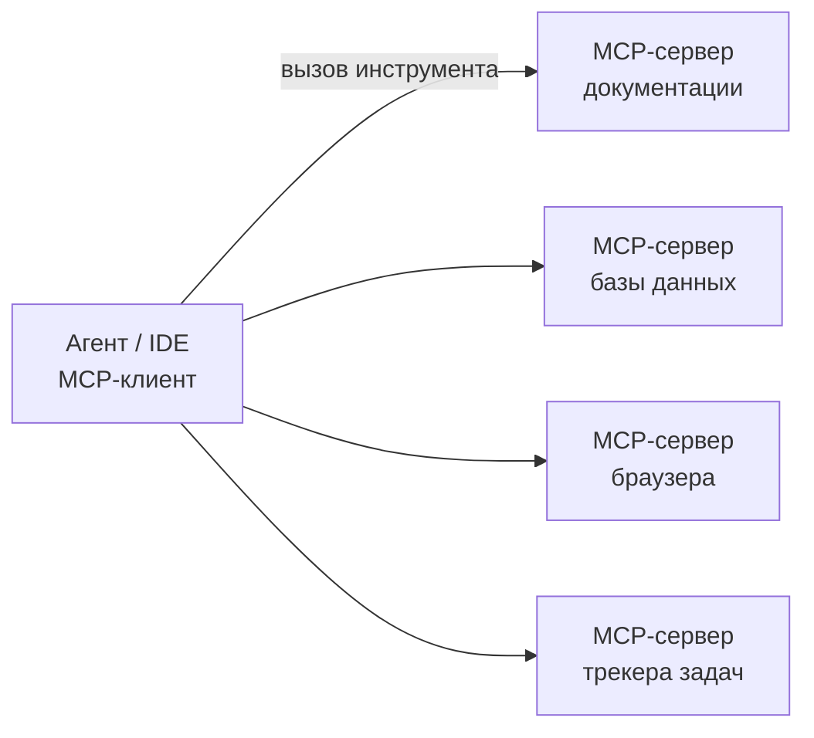

# Урок 03. MCP, AGENTS.md и навыки: как дать агенту правильный контекст

[← К оглавлению](../README.md)

Агент знает языки программирования, но не знает **твой** проект: как его собрать, где что лежит, какие правила у команды. Хороший контекст — самый дешёвый способ улучшить результат.

## 1. AGENTS.md — инструкция для агентов

`AGENTS.md` — открытый формат файла в корне репозитория. Его читают Codex, Cursor, GitHub Copilot, Gemini CLI, Aider, Zed, Jules и многие другие. Claude Code читает `CLAUDE.md` (можно сделать его ссылкой на `AGENTS.md` или просто продублировать).

### Что писать

| Раздел | Пример |
|---|---|
| Обзор | «Монорепо: `apps/web` — Next.js, `apps/api` — FastAPI, `packages/ui` — общие компоненты» |
| Команды | установка, запуск, тесты, линтер, сборка — точные команды |
| Стиль | форматтер, соглашения об именах, запреты (`any`, `print` в проде) |
| Архитектура | куда класть новый код, какие слои нельзя смешивать |
| Тесты | как запускать один тест, требование покрывать новый код |
| Опасные зоны | миграции, секреты, генерируемые файлы — «не трогать без просьбы» |
| Git | формат коммитов, правила веток |

### Чего не писать

- Общие советы вроде «пиши чистый код» — модель это и так знает.
- Секреты и токены.
- Тысячи строк: держи файл коротким (до ~200 строк), подробности — в отдельных документах со ссылками.

### Вложенные файлы

В монорепо можно положить `AGENTS.md` в подпапки — агент возьмёт ближайший к редактируемому файлу.

### Проверка и генерация

- [ctxlint](https://github.com/YawLabs/ctxlint), [cc-audit](https://github.com/sisyphusse1-ops/cc-audit) — линтеры файлов правил.
- [Caliber](https://github.com/rely-ai-org/caliber), [sourcebook](https://github.com/maroondlabs/sourcebook), [ContextKit](https://nova-labs.dev/contextkit/generate) — генерация черновика из кода.
- [intelligence-sync](https://github.com/ainova-systems/intelligence-sync), [LynxPrompt](https://github.com/GeiserX/LynxPrompt) — синхронизация правил между инструментами.

## 2. MCP — подключение агента к миру

**Model Context Protocol** — открытый стандарт: MCP-сервер описывает набор инструментов (функций), а клиент (Claude Code, Cursor, Cline, Windsurf, VS Code, Codex, Gemini CLI и др.) даёт модели возможность их вызывать.



### Полезные типы MCP-серверов

| Тип | Зачем | Пример из каталога |
|---|---|---|
| Документация библиотек | Актуальные API вместо устаревших знаний модели | [Context7](https://context7.com/) |
| Поиск по коду | Быстрый поиск в большом репозитории | [Reflex](https://github.com/reflex-search/reflex), [codesight](https://github.com/Houseofmvps/codesight) |
| Знания команды | Документы, решения, переписка | [SwarmVault](https://github.com/swarmclawai/swarmvault), [Nex](https://github.com/nex-crm/nex-as-a-skill) |
| UI-компоненты | Генерация по дизайн-системе | [shadcn/studio MCP](https://shadcnstudio.com/mcp), [FlyonUI MCP](https://flyonui.com/mcp) |
| Инфраструктура | Kubernetes, облака | [kc-agent](https://github.com/kubestellar/console) |

### Как подключить

**Claude Code:**

```bash
claude mcp add context7 -- npx -y @upstash/context7-mcp
claude mcp list
```

**Cursor / Cline / Windsurf / VS Code** — JSON-конфиг MCP (расположение файла зависит от инструмента):

```json
{
  "mcpServers": {
    "context7": {
      "command": "npx",
      "args": ["-y", "@upstash/context7-mcp"]
    }
  }
}
```

### Безопасность MCP

- Устанавливай серверы только из доверенных источников: MCP-сервер выполняется на твоей машине с твоими правами.
- Не подключай одновременно сервер, читающий недоверенный контент (веб, чужие issues), и сервер с доступом к секретам или продакшену — это открывает дорогу prompt injection.
- Давай токены с минимальными правами (только чтение, где возможно).

## 3. Навыки (Skills)

Навык — папка с `SKILL.md` (описание и инструкции) и, при необходимости, скриптами. Агент видит только краткое описание навыка и загружает его целиком, когда задача подходит. Так можно хранить десятки процедур («как выпускать релиз», «как писать миграции») без раздувания контекста.

Каталоги навыков: [Conduit8](https://github.com/conduit8/conduit8), [TokRepo](https://github.com/henu-wang/tokrepo). Проверка качества навыков на разных моделях: [skill-optimizer](https://github.com/fastxyz/skill-optimizer).

## 4. Экономия контекста

| Приём | Эффект |
|---|---|
| Новая сессия на новую задачу | Модель не путается в старом контексте |
| Короткий AGENTS.md + ссылки на детали | Меньше токенов в каждой сессии |
| Инструменты сжатия контекста ([lean-ctx](https://leanctx.com), [Entroly](https://github.com/juyterman1000/entroly)) | Меньше токенов на чтение файлов и вывод команд |
| Субагенты для поиска | Основной контекст не засоряется результатами поиска |

[← Урок 02](02-lokalnye-modeli.md) · [Урок 04 →](04-teoriya.md)
