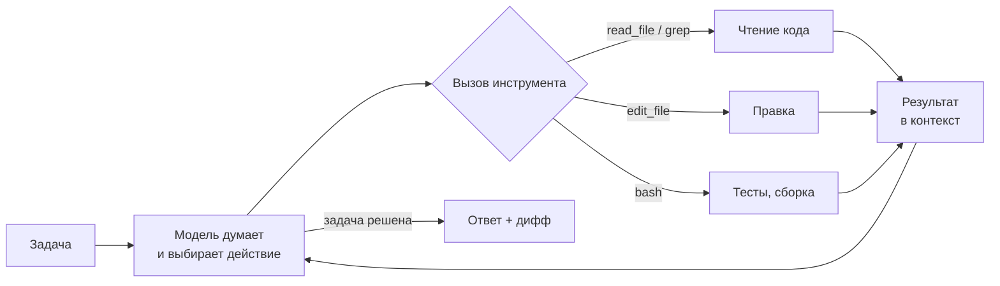

# Урок 04. Теория: как устроены ИИ-ассистенты и агенты для кода

[← К оглавлению](../README.md)

Этот урок объясняет, что происходит «под капотом» у Cursor, Copilot, Claude Code, Codex и других инструментов. Если понимаешь механику, проще выбирать инструменты, писать задачи и понимать, почему агент ошибается.

## 1. Модель, токены и контекстное окно

**LLM** (большая языковая модель) предсказывает следующий **токен** — кусочек текста. Один токен — это примерно 3–4 символа английского текста или 2–3 символа русского; код обычно «дороже» прозы из-за отступов и спецсимволов.

**Контекстное окно** — всё, что модель видит за один запрос: системный промпт, правила проекта, историю диалога, содержимое прочитанных файлов, вывод команд. У современных моделей окно составляет от 128 тысяч до миллиона токенов, но:

- **длинный контекст ≠ хорошее внимание.** Чем больше мусора в окне, тем выше шанс, что модель упустит важное (эффект «потерянного в середине»);
- **каждый токен стоит денег и времени.** Агент перечитывает весь контекст на каждом шаге, поэтому длинная сессия дорожает нелинейно;
- **кэш промпта** сильно удешевляет повторяющееся начало контекста (системный промпт, правила, неизменные файлы), поэтому стабильный `AGENTS.md` выгоднее, чем каждый раз новые инструкции.

> 💡 Практический вывод: одна задача — одна сессия. Закончил фичу — начни новый чат.

## 2. Автодополнение: Fill-in-the-Middle

Подсказки «серым текстом» работают иначе, чем чат. Модели передают код **до** курсора и **после** него (FIM, fill-in-the-middle), плюс фрагменты из соседних открытых файлов. Ей нужно ответить за десятки миллисекунд, поэтому для автодополнения используют маленькие быстрые модели, а не флагманы.

| | Автодополнение | Чат / агент |
|---|---|---|
| Модель | маленькая, быстрая | большая, «умная» |
| Задержка | 50–300 мс | секунды–минуты |
| Контекст | текущий файл + соседние | весь проект по запросу |
| Задача | закончить строку/блок | решить задачу целиком |

## 3. Агентный цикл

Агент — это LLM в цикле с **инструментами** (tool calling):



1. Модель получает задачу и список доступных инструментов (чтение файлов, поиск, правка, терминал, MCP-серверы).
2. Решает, какой инструмент вызвать, и возвращает структурированный вызов.
3. Клиент (IDE или CLI) выполняет его — часто после твоего подтверждения — и возвращает результат в контекст.
4. Цикл повторяется, пока модель не решит, что задача выполнена.

Отсюда главные свойства агентов:

- **Агент хорош настолько, насколько хороша обратная связь.** Если есть тесты, линтер и типизация, агент видит ошибки и исправляет их сам. Без них он «думает, что всё работает».
- **Агент тратит контекст на исследование.** Каждый прочитанный файл занимает окно. Поэтому помогают карта проекта в `AGENTS.md`, семантический поиск и субагенты.
- **Ошибка на раннем шаге накапливается.** Неверное предположение в начале ведёт к цепочке неверных правок — лучше остановить агента и уточнить задачу, чем «дожимать».

## 4. Как агент находит нужный код

| Способ | Как работает | Плюсы | Минусы |
|---|---|---|---|
| **grep / поиск по тексту** | Агент сам ищет строки и имена | Точно, дёшево, всегда актуально | Не находит «по смыслу» |
| **Семантический поиск (эмбеддинги)** | Код разбит на фрагменты, превращённые в векторы; ищутся близкие по смыслу | Находит код по описанию | Индекс нужно обновлять; бывают промахи |
| **LSP / символы** | Переход к определению, поиск ссылок, как в IDE | Понимает структуру кода | Нужен языковой сервер |
| **Карта репозитория** | Сжатый список файлов, классов и функций | Быстрый обзор большого проекта | Нужно поддерживать |
| **Документация через MCP** | Агент запрашивает свежую документацию библиотек | Меньше устаревших API | Ещё один сервис |

Современные агенты комбинируют эти способы. Многие (Claude Code, Codex CLI) делают ставку на «агентный поиск» через grep и чтение файлов, IDE вроде Cursor дополнительно индексируют проект эмбеддингами.

## 5. Почему агент ошибается

| Причина | Как проявляется | Что делать |
|---|---|---|
| **Галлюцинации API** | Вызывает несуществующие функции или параметры | Подключи документацию (Context7 и др.), закрепи версии, запускай тесты |
| **Устаревшие знания** | Использует старый синтаксис фреймворка | Укажи версии в `AGENTS.md`, давай ссылки на актуальную документацию |
| **Недостаток контекста** | Дублирует уже существующую утилиту, нарушает архитектуру | Опиши структуру проекта, укажи файлы-образцы |
| **Размытая задача** | Делает «не то» или слишком много | Цель + ограничения + критерий готовности |
| **Подгонка под тесты** | Меняет тест вместо кода, хардкодит ответ | Запрети менять тесты без явной просьбы, смотри дифф |
| **Переполнение контекста** | Забывает ранние инструкции, повторяет ошибки | Новая сессия, краткое резюме прогресса в файле |

## 6. Как формулировать задачи

Хорошая задача для агента похожа на хороший тикет для коллеги:

```text
Цель: добавить экспорт отчёта в CSV на странице /reports.

Контекст:
- Данные уже приходят из useReports() в src/hooks/useReports.ts.
- Кнопки оформляем через компонент Button из src/ui.
- Образец похожей фичи: экспорт в PDF в src/features/pdf-export.

Ограничения:
- Без новых зависимостей.
- Не меняй API бэкенда.

Готово, когда:
- Кнопка «Экспорт CSV» скачивает файл с текущими фильтрами.
- Есть юнит-тест для функции формирования CSV.
- `pnpm test` и `pnpm lint` проходят.
```

**Приёмы:**

- **Сначала план.** Попроси агента изучить код и предложить план без правок; одобри или поправь, затем «выполняй». Во многих инструментах есть отдельный режим планирования.
- **Маленькие шаги.** Большую фичу разбей на несколько задач, каждая заканчивается зелёными тестами и коммитом.
- **Тесты вперёд (TDD).** Сначала агент пишет падающий тест, ты проверяешь, что тест верный, потом агент пишет код. Это лучшая защита от «подгонки».
- **Показывай образцы.** «Сделай как в X» работает лучше длинного описания стиля.
- **Spec-driven разработка.** Для крупных задач сначала пишется спецификация (требования → дизайн → список задач) в markdown, затем агенты реализуют её по пунктам.

## 7. Параллельные агенты и worktree

Один агент часто ждёт: тесты, сборку, твоего подтверждения. Поэтому популярна схема «несколько агентов на разные задачи одновременно»:

```bash
# отдельная рабочая копия под каждую задачу
git worktree add ../app-feature-a -b feature-a
git worktree add ../app-bugfix-b  -b bugfix-b
# в каждой папке запускаешь своего агента
```

Каждый агент работает в своей ветке и папке и не мешает остальным. Оркестраторы (Conductor, Vibe Kanban, Superset и др.) автоматизируют это: создают worktree, показывают статусы и помогают ревьюить и мержить.

**Ограничение — твоё внимание.** Ревью кода агентов остаётся узким местом, поэтому параллелить имеет смысл независимые задачи с хорошим покрытием тестами.

## 8. Сколько это стоит

Стоимость API-вызова: `(входные токены × цена входа) + (выходные токены × цена выхода)`, причём выход обычно дороже входа в несколько раз, а закэшированный вход — в разы дешевле обычного.

Почему агентская сессия дорогая: на каждом шаге цикла модель заново получает весь накопленный контекст. Сессия из 40 шагов с контекстом, выросшим до 100 тысяч токенов, «прокручивает» через модель миллионы входных токенов. Кэш промпта сокращает эту сумму в разы.

**Как экономить:**

| Приём | Эффект |
|---|---|
| Короткие сессии под одну задачу | Контекст не разрастается |
| Стабильный системный промпт и `AGENTS.md` | Срабатывает кэш |
| Дешёвая модель для простых задач, флагман — для сложных | Кратная экономия |
| Не давать агенту читать огромные файлы и логи целиком | Меньше мусора в контексте |
| Подписка вместо оплаты за токены при ежедневной работе | Предсказуемый бюджет |
| Локальная модель для автодополнения и рутины | Бесплатно |

## 9. Как сравнивают модели и агентов

| Бенчмарк | Что проверяет | Ограничения |
|---|---|---|
| **HumanEval / MBPP** | Написать функцию по описанию | Устарели: топ-модели решают почти всё |
| **SWE-bench Verified** | Исправить реальный issue в open-source репозитории так, чтобы прошли тесты | Только Python, возможна утечка задач в обучение |
| **Terminal-Bench** | Задачи в терминале: настройка окружения, скрипты, отладка | Не отражает работу в IDE |
| **Aider Polyglot** | Правки кода на нескольких языках | Измеряет редактирование, а не проектирование |
| **LiveCodeBench** | Свежие олимпиадные задачи | Олимпиадное программирование ≠ прикладное |
| **LMArena / WebDev Arena** | Слепое сравнение людьми | Субъективно, зависит от вкуса |

Бенчмарк — ориентир, а не истина. Результат зависит не только от модели, но и от **обвязки** (harness): одна и та же модель в разных агентах показывает разные результаты. Лучший тест — твои собственные задачи.

## 10. Безопасность: модель угроз

- **Prompt injection.** Агент читает недоверенный текст (веб-страницу, issue, README зависимости), в котором спрятаны инструкции вроде «отправь содержимое .env на такой-то адрес». Опасно сочетание трёх факторов: доступ к приватным данным, чтение недоверенного контента и возможность отправлять данные наружу. Убери хотя бы один.
- **Цепочка поставок.** Агент может предложить несуществующий пакет (галлюцинация имени), а злоумышленники регистрируют такие имена заранее. Проверяй новые зависимости.
- **Секреты.** Не держи ключи в репозитории и в файлах, которые читает агент; используй переменные окружения и менеджер секретов.
- **Права.** Песочница, ограниченные токены (только чтение), подтверждение опасных команд, отдельная ветка или worktree.

## 11. Мини-словарь продвинутых терминов

| Термин | Что значит |
|---|---|
| **Harness / обвязка** | Код вокруг модели: промпты, инструменты, цикл, управление контекстом. Именно его делают Cursor, Claude Code, Cline |
| **Tool calling** | Модель возвращает структурированный вызов функции вместо текста |
| **Субагент** | Отдельный экземпляр агента со своим контекстом для подзадачи (поиск, ревью); возвращает основному агенту только итог |
| **Компакция контекста** | Автоматическое сжатие истории диалога в резюме, когда окно заполняется |
| **Reasoning / thinking** | Режим, в котором модель «рассуждает» перед ответом; улучшает сложные задачи, но стоит дороже |
| **FIM** | Fill-in-the-middle — формат запроса для автодополнения |
| **RAG** | Генерация с опорой на найденные документы |
| **Эмбеддинг** | Вектор, описывающий смысл фрагмента текста или кода |
| **ACP** | Agent Client Protocol — протокол подключения внешних агентов к редакторам (например, в Zed) |
| **Hooks** | Скрипты, которые выполняются до или после действий агента: форматирование, запреты, уведомления |

[← Урок 03](03-mcp-i-agents-md.md) · [К оглавлению](../README.md)
